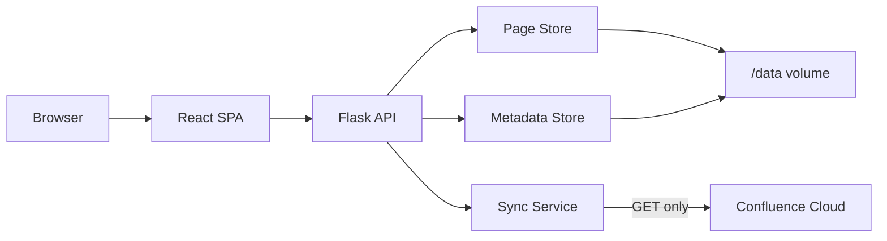

# Runbook Manager

## Project Overview

Runbook Manager retrieves and manages content from Confluence. It treats Confluence as a strictly read-only source, and keeps classification, prioritization, and review state in application-owned files.

## Tech Stack

| Layer | Technology |
|-------|-----------|
| Runtime | Python 3.12 |
| Backend | Flask 3.1 + Gunicorn |
| Frontend | React 18 + Vite + Tailwind CSS |
| Search | Backend title filtering |
| Storage | File-based JSON (persistent volume `/data`) |
| Container | Azure Container Apps |

## Flow Diagram



## Project Owner

| Role | Contact |
|------|---------|
| Owning team | Set locally |
| Primary contact | Set locally |
| Escalation | Set locally |

## Local Development

### Prerequisites

- Python 3.12
- Node.js 20
- Git

### Setup

1. Clone the repository:
   ```bash
   git clone <repo-url>
   cd runbooks-app
   ```

2. Copy the example env file and fill in your values:
   ```bash
   cp .env.example .env.local
   ```

3. Install Python dependencies:
   ```bash
   pip install -r requirements.txt
   ```

4. Install frontend dependencies and build:
   ```bash
   cd frontend
   npm install
   npm run build
   cd ..
   ```

5. Start the app:
   ```bash
   python run.py
   ```

The app runs at **http://localhost:4747** (VibeOps dev port).

For frontend development with hot reload, run Vite dev server separately:
```bash
cd frontend
npm run dev
```
This starts the frontend at http://localhost:5173 with API proxying to the Flask backend.

> **Note:** Platform-managed variables (`PORT`, `HOST`, `AZURE_KV_URL`) are set automatically when you deploy. You do not need Azure access to develop locally.

### Environment Variables

All configuration is read from environment variables. See `.env.example` for the full list. Key variables:

- `CONFLUENCE_BASE_URL` — Atlassian base URL
- `CONFLUENCE_EMAIL` — API authentication email
- `CONFLUENCE_API_TOKEN` — Atlassian API token (read-only)
- `CONFLUENCE_SPACE_KEYS` — Comma-separated space keys to sync
- `DATA_DIR` — Local data directory (defaults to `data/`, `/data` in production)

### Read-Only Guarantee

The application never modifies Confluence. All API calls are GET-only. Local metadata (priority, owner, domain, status, notes) is stored in application-owned JSON files and never written back to Atlassian.
